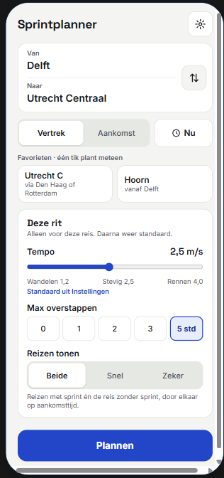
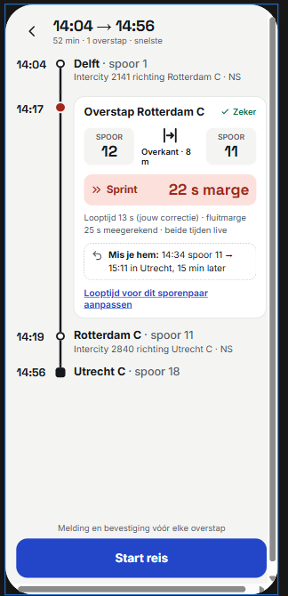
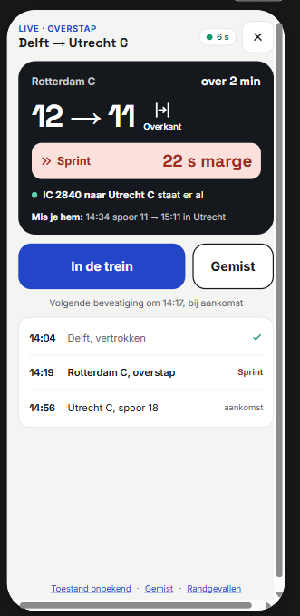

# Sprintplanner

**A personal train planner that shows the tight transfers the official Dutch planners leave out, and is honest about the risk.**

Sprintplanner is a product I designed and directed from start to finish: the concept, the transfer model, the architecture, the UX and the rules for how the app deals with uncertainty. The code was written by an AI coding agent (Claude Code) working from my plans and specs, with automated tests and review rounds. This page describes the product and the design decisions behind it. The source code is private.

> Status (November 2026): the planning core runs on the real Dutch timetable and is in use on my own trips. Live re-planning during a trip and the full mobile app are in progress.

<table>
  <tr>
    <td align="center"> Results</td>
    <td align="center"> Trip detail</td>
    <td align="center"> Live</td>
  </tr>
</table>

*Design mockups; all times, train numbers and margins are fictional.*

---

## The problem

The NS app and 9292 let you *add* extra transfer time, but never take any away. Their transfer norms are built for the average traveller, so connections that are perfectly doable for a fit traveller who knows the station disappear from the results. A cross-platform transfer with 90 seconds to spare is a good example. The planner then suggests the train fifteen minutes later.

Research by the Dutch passenger organisation Rover found that travellers would rather see an uncertain connection *with a warning* than not see it at all. Sprintplanner takes that idea one step further. It shows transfers below the official norm, as long as a short sprint can make them, and says plainly how tight each one is.

**Example (fictional times).** You arrive at Den Haag HS on platform 5. A train to Utrecht leaves from platform 6, across the same platform, 90 seconds later. The NS planner advises the train a quarter of an hour later. Sprintplanner shows both. The tight option is labelled *across the platform, 60 s margin, miss it and you arrive 15 minutes later*.

## Results so far

I compared it with the official NS planner at 40 departure times on my regular routes (Delft to Utrecht and Delft to Hoorn, both directions):

- **32 of 40:** same arrival as NS.
- **8 of 40:** an earlier arrival, between **2 and 19 minutes**. Every one of these comes from a transfer below the NS minimum. Example: Delft to Hoorn via Schiphol, 18 to 19 minutes faster in the evening.
- **With NS transfer norms switched on: 40 of 40** identical arrivals. The planning core is correct, and the differences come only from the transfer model, which is the point.
- Caveat: walking times at Schiphol and Amsterdam Sloterdijk are still estimates. The app labels them as such, and measuring them is part of the next phase.

Other figures: over 115 automated tests, and the whole app uses about 75 MB of memory, so it fits a small home server (512 MB).

---

## Design decisions

Each decision below was a trade-off. For each one I note what I chose and what I gave up. Decisions marked *(in progress)* are fully designed but not built yet.

### 1. Show tight transfers, but never without a safety net
A tight transfer is never shown on its own. It always comes with its margin, how certain that margin is, and the **cost of missing it** (when you arrive instead). The journey without a sprint is always in the list too.
*Trade-off:* the results are busier than in a "one best answer" planner. I accepted that, because hiding the choice is exactly the problem this app exists to solve.

### 2. A personal transfer model per pair of platforms
Transfer time depends on *which* platforms are involved and on *your* walking speed, not on a fixed time per station. The model works per platform pair. It uses my own pace and my measured times where I have them (for example, "anything at Rotterdam Centraal within 45 s"), and falls back to a formula. Every walking time shows where it came from: *my time*, *OpenStreetMap* or *estimated*.
*Trade-off:* more data to maintain. That's why walking times can be corrected in the app, straight from the transfer they apply to.

### 3. Honest labels instead of false precision
Margins get a colour, an icon **and** a word: **Comfortable** (≥ 2 min), **Tight** (30 s to 2 min), **Sprint** (< 30 s). An uncertain margin is shown as a range ("20–80 s") with a dashed border. A transfer that is probably too short says so ("You probably won't make this").
*Principle:* the app is never more precise than its data.

### 4. The search uses expected times; uncertainty only goes into the labels
If the search itself were pessimistic, tight transfers would vanish from the results, which is exactly what the official planners do. So the search runs on expected times, and the uncertainty band only affects the label, the certainty flag and the in-trip "unknown" state.
*Trade-off:* the result list can include options that turn out impossible. They are always marked, and the fallback is always visible.

### 5. A delay is a range, not a number *(in progress)*
A real-time delay is a forecast. For a transfer only one direction is dangerous: your own train getting *later*, or the connecting train *making up time* and leaving earlier than forecast. Each real-time time therefore gets a band on its dangerous side only, and the band shrinks as the moment gets closer.
*Trade-off:* the app says "unknown" more often during delays. That's correct, and better than a confident wrong answer.

### 6. Fewer transfers unless an extra one is really worth it
An extra transfer only appears if it saves at least **2 minutes** (adjustable). Below that, the simpler journey wins. When two journeys arrive at the same time, the one that leaves latest wins.

### 7. Silence is not good news *(in progress)*
Before every transfer, the app sends a confirmation notification. If it doesn't arrive, I know to look myself. When the app can't tell whether I caught a train, it asks ("Did you catch IC …?") and shows both outcomes side by side, instead of guessing.

### 8. Designed for the platform: the next step comes first *(in progress)*
On the platform you don't want the whole plan, you want the next step. The live screen puts that step in one high-contrast card: station, countdown, platforms in large type, type of transfer, margin. It has 64 px buttons within thumb reach. The light theme is chosen for reading in sunlight.

### 9. Per-trip choices versus defaults, and two levels of settings *(in progress)*
Walking pace, maximum transfers and *Both / Fast / Safe* can be changed for **one trip** on the planning screen, without touching the defaults. A bar shows when a trip deviates from them. The settings screen only shows what I actually change. All fine-tuning (margins, whistle margin per operator, search limits) lives on a separate *Advanced* screen.

### 10. Built to run on a 512 MB home server
The app is one Python process with everything in memory and no separate database server. It runs in Docker, and a sleep mode stops it computing all day. Each real-time update builds a new, immutable snapshot of the timetable and swaps it in at once, so a search never sees half-updated data. The routing core has no network access, no files and no clock: the current time is a parameter. That makes every situation, including real recorded disruptions, replayable as a test.
*Trade-off:* each piece of real-time data has to fit a strict memory budget, so each new data source has to justify its place.

### 11. Disruptions as a core feature, not an extra *(in progress)*
This is the moment when tight transfers matter most: everyone runs for the same replacement train. The design covers cancellations, large delays, platform changes, a full blockage between two stations, and planned engineering works. When sources disagree, the app shows both versions with a warning. NS recovery-time estimates are shown, but never treated as fact.

### 12. Reuse proven designs, credit them
Wherever an open-source project had already solved part of the problem well, such as streaming timetable import or journey monitoring, I adopted the *design* and credited the project, rather than reinventing it.

---

## How it's built

| | |
| --- | --- |
| **Data** | Dutch national timetable (GTFS via OVapi, plus NS IFF data for transfer times and through-trains); NS API for real-time and disruptions. Open data and official APIs only, no scraping |
| **Routing** | Connection Scan Algorithm, per number of transfers, with forward search (depart at) and backward search (arrive by) |
| **Backend** | Python, Starlette, in-memory model, Docker; GitHub Actions for tests and images |
| **Frontend** | Mobile web app (PWA) with plain HTML/JavaScript and no build step; Web Push notifications |
| **Hosting** | Synology NAS at home, reached privately over Tailscale; external health checks |

## My role

- **Product & UX:** problem definition, concept, the flow and all screens, labels, settings structure, wish list.
- **Architecture & rules:** layering, the transfer model, how uncertainty is handled, memory budget, test strategy (including the comparison with the NS planner).
- **Directing an AI developer:** writing build plans and specs, splitting the work into blocks with clear "done when" criteria, reviewing results against the plan, and making the calls on every trade-off.

---

© 2026 Jelle Stap. All rights reserved. NS is a trademark of Nederlandse Spoorwegen; Sprintplanner is an independent project and not affiliated with NS.
